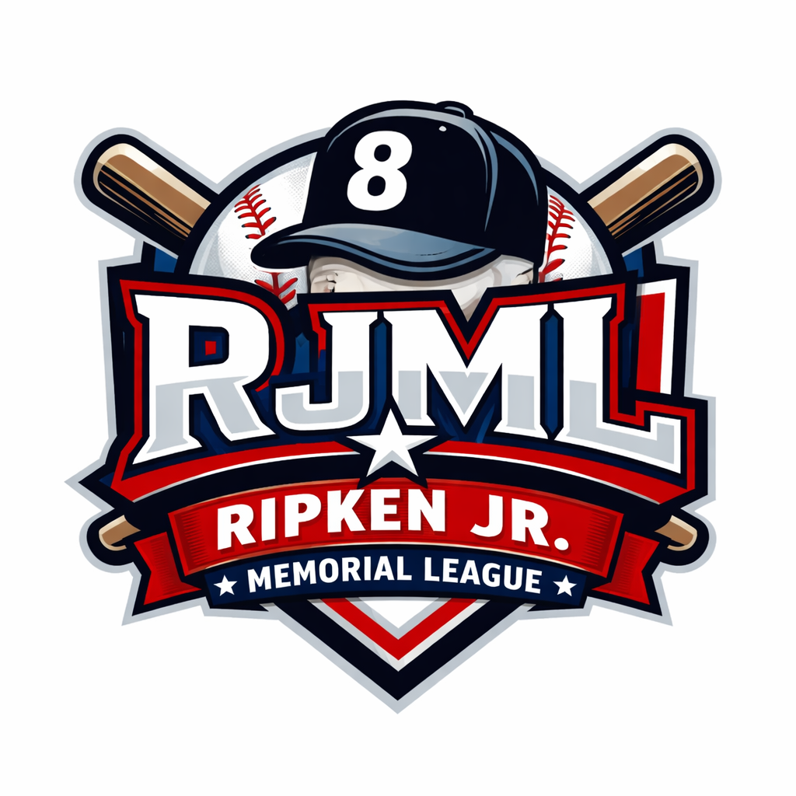
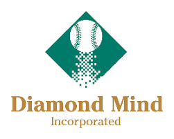

```{css, echo=FALSE}
.logo-grid {
  display: grid;
  grid-template-columns: repeat(6, 1fr); /* 6 equal columns */
  gap: 20px;                             /* Space between grid items */
  text-align: center;
  margin-top: 20px;
}

.grid-item {
  display: flex;
  flex-direction: column;
  align-items: center;
  justify-content: space-between;
}

.grid-item img {
  max-width: 100%;
  height: auto;
  max-height: 80px;                     /* Keeps logos uniform in height */
  object-fit: contain;
}

.grid-item a {
  margin-top: 8px;
  font-size: 0.7em;
  text-decoration: none;
  color: #000000;
}

.grid-item a:hover {
  text-decoration: underline;
}
```


```{r setup, include=FALSE}
knitr::opts_chunk$set(echo = FALSE)
library(tidyverse)
```


:::::::::::::: {.columns}


::: logo-grid

<!-- Row 1 -->
::: grid-item
[{width=100px}](ALA.html)
<br>Alameda
:::

::: grid-item
[{width=100px}](ARB.html)
<br>Arboga
:::

::: grid-item
[{width=100px}](BEA.html)
<br>Beauce
:::

::: grid-item
[{width=100px}](BRA.html)
<br>Bradenton
:::

::: grid-item
[{width=100px}](CAM.html)
<br>Camarillo
:::

::: grid-item
[{width=100px}](CK.html)
<br>Central Kentucky
:::

::: grid-item
[{width=100px}](DAY.html)
<br>Dayton
:::

::: grid-item
[{width=100px}](DV.html)
<br>Death Valley
:::

::: grid-item
[{width=100px}](EVA.html)
<br>Evansville
:::

::: grid-item
[{width=100px}](GH.html)
<br>Gig Harbor
:::

::: grid-item
[{width=100px}](GNB.html)
<br>Granby

:::

::: grid-item
[{width=100px}](GRF.html)
<br>Grafton

:::

::: grid-item
[{width=100px}](HAL.html)
<br>Haliburton

:::

::: grid-item
[{width=100px}](HAR.html)
<br>Harrison

:::

::: grid-item
[{width=100px}](HOM.html)
<br>Homestead
:::

<!-- Row 3 -->
::: grid-item
[{width=100px}](NB.html)
<br>New Britain
:::

::: grid-item
[{width=100px}](PR.html)
<br>Powder River
:::

::: grid-item
[{width=100px}](HV.html)
<br>Highland Village
:::

::: grid-item
[{width=100px}](ROC.html)
<br>Rochester
:::


::: grid-item
[{width=100px}](RAM.html)
<br>Ramey
:::

::: grid-item
[{width=100px}](SV.html)
<br>Silicon Valley
:::

::: grid-item
[{width=100px}](TB.html)
<br>Thunder Bay
:::
::: grid-item
[{width=100px}](VAN.html)
<br>Vancouver
:::

::: grid-item
[{width=100px}](WHI.html)
<br>Whitby
:::

:::
<center>
{width=120px} *A 24 team simulation baseball league powered by Diamond Mind Baseball.* 
[{width=80px}](https://diamond-mind.com/) 
</center>


::::::::::::::


  
  

